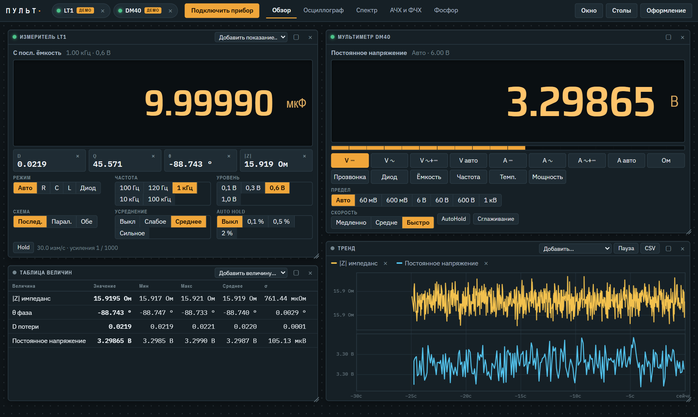
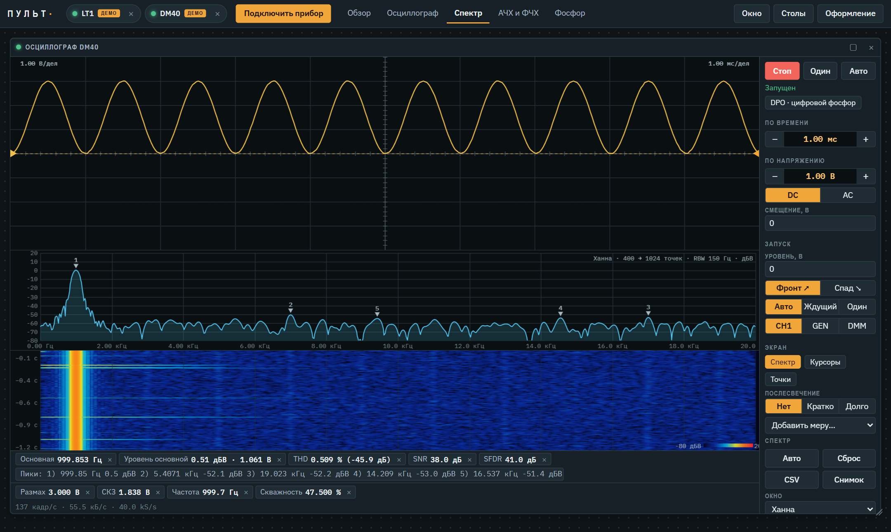
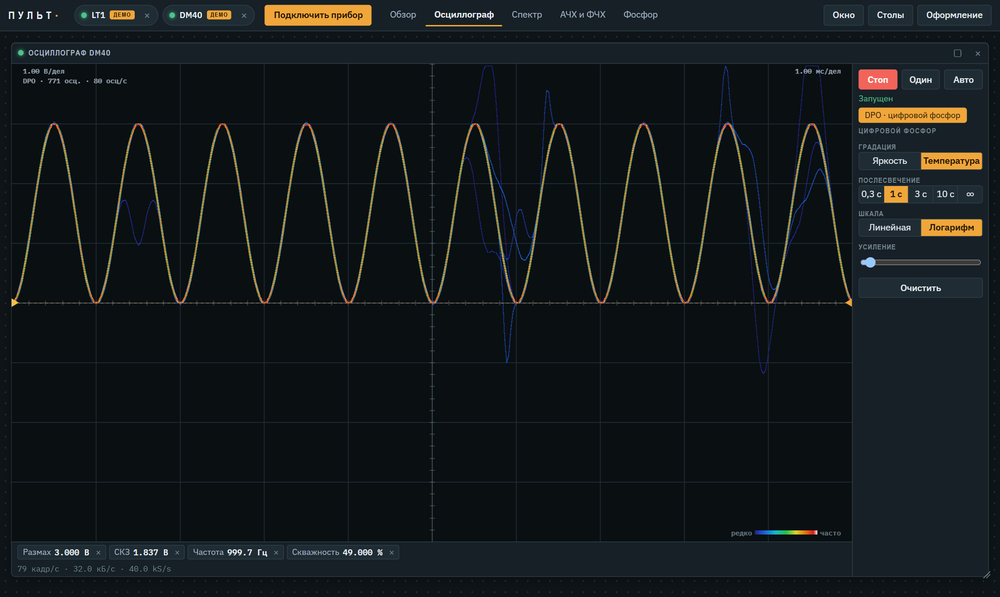
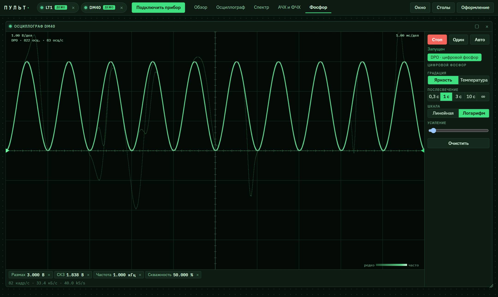
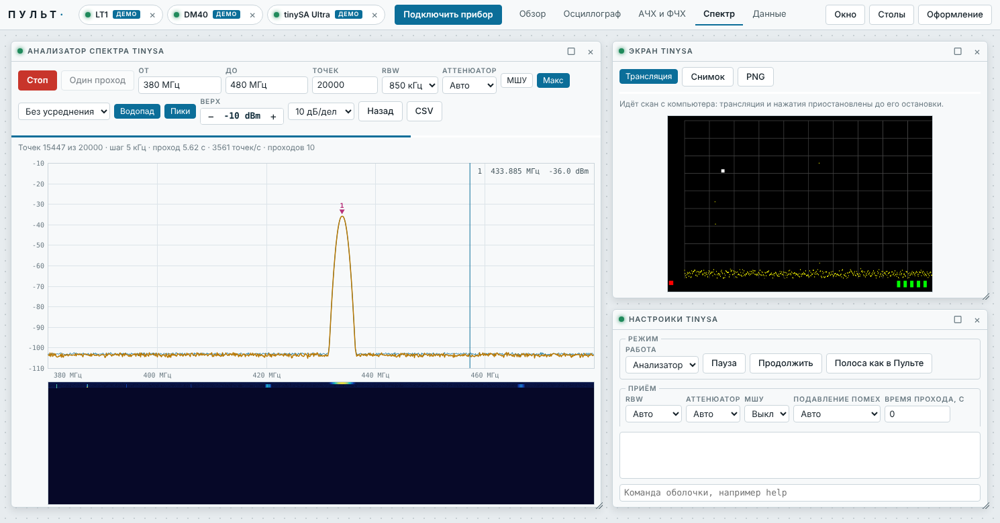
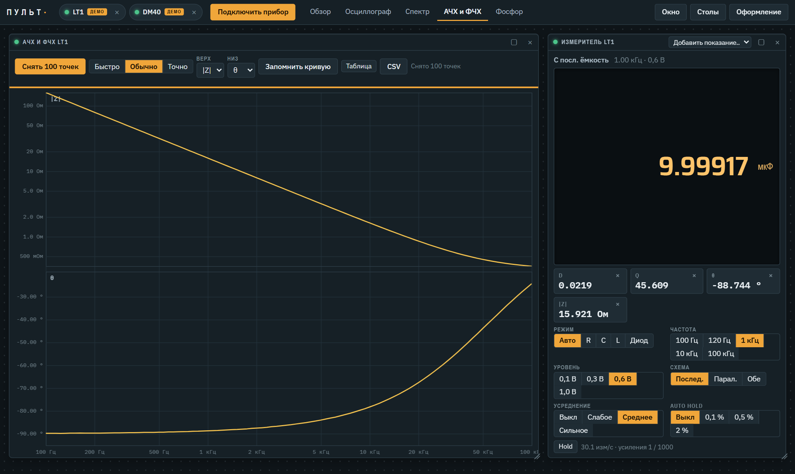

# Пульт

Браузерная панель управления измерительными приборами. Один HTML-файл без установки и без сервера: открыл в Chrome или Edge, подключил прибор, работаешь.

Поддерживаемые приборы:

- **ALIENTEK ATK-PTLT1 (LT1)**, LCR-метр, с доработанной прошивкой fix5 (2.0) и её SCPI-командами.
- **ALIENTEK DM40**, мультиметр-осциллограф, с открытой прошивкой [opendm40](https://github.com/StepanKoshman/opendm40) (USBTMC, Bluetooth, SCPI).

- **tinySA Ultra / Ultra+ (ZS405, ZS406, ZS407)**, анализатор спектра, по USB (виртуальный COM-порт, штатная оболочка прибора).
- **ALIENTEK C2 (Lite, Std, Pro)**, тестер USB: напряжение и ток VBUS, мощность, D+, D−, CC1, CC2, триггер протоколов быстрой зарядки, анализатор PD, e-marker, записи в приборе, калибровка и обновление прошивки.

Без прибора работает встроенный симулятор всех четырёх приборов.



## Скриншоты

**Спектр и водопад.** БПФ сигнала с осциллографа DM40, пики, THD, SNR, SFDR и водопад, как на трансивере.



**Цифровой фосфор (DPO).** Редкие выбросы остаются видны на фоне основного сигнала. Слева градация цветовой температурой, справа яркостью в теме «Фосфор».

| Цветовая температура | Яркость |
|---|---|
|  |  |

**tinySA.** Скан с компьютера на 20 000 точек с удержанием максимума, пиками и водопадом, рядом трансляция экрана прибора и настройки.



**АЧХ и ФЧХ LT1.** Скан импеданса и фазы на 100 частотах, от 100 Гц до 100 кГц.



Все снимки сделаны на встроенных симуляторах.

## Запуск

Скачайте `pult.html` из [последнего выпуска](https://github.com/StepanKoshman/pult/releases/latest) (или [`dist/pult.html`](dist/pult.html) из репозитория) и откройте в браузере.

| Подключение | Браузер |
|---|---|
| USB (WebUSB / Web Serial) | Chrome, Edge |
| tinySA: «COM-порт и Bluetooth SPP», в списке портов выбрать tinySA | Chrome, Edge на компьютере |
| C2: «C2 по USB» (WebUSB, драйвер WinUSB Windows ставит сама) | Chrome, Edge |
| C2 Std и Pro: «C2 по Bluetooth LE» или «C2 через COM или SPP» | Chrome, Edge |
| C2: «C2 через мост» (`bridge.py c2`) | любой |
| COM-порт или Bluetooth SPP через мост | любой, включая Firefox и Safari |

Мост для браузеров без WebUSB и Web Serial:

```bash
pip install pyserial
python dist/bridge.py COM7
```

После этого в Пульте укажите адрес `ws://localhost:8765`.

C2 по USB через мост (нужен драйвер WinUSB, Windows ставит его сама):

```bash
pip install pyusb libusb-package
python dist/bridge.py c2
```

Команду входа в обновление прошивки мост передаёт прибору, только если Пульт перед ней явно попросил об обновлении.

## Возможности

- Окна приборов на рабочем столе: перемещение, изменение размера, сохранение раскладки.
- LT1: окно «Измеритель» и окно «АЧХ и ФЧХ». Набор частот берётся из версии прошивки: с fix5 2.3 верхняя частота 50 кГц, раньше 100 кГц.
- C2, рабочие столы «C2», «C2: PD» и «C2: сервис»:
  - **тестер и графики**: напряжение, ток, мощность, D+, D−, CC1, CC2, температура, А·ч и Вт·ч, частота измерений прибора до 1000 в секунду, запись в CSV;
  - **триггер и протоколы**: PD, QC2.0, QC3.0, FCP, SCP, AFC, VFCP, UFCS, VOOC, SVOOC, режимы источника, автоопределение протоколов;
  - **анализатор PD**: прослушка линии CC, расшифровка сообщений, скрытие GoodCRC, CSV;
  - **e-marker**: чтение, правка, запись, экспорт и импорт двух ячеек;
  - **записи в приборе**: офлайн-записи, перенос в графики и CSV;
  - **калибровка** V и I по эталону (например, DM40) с резервной копией, состояние самокалибровки и усреднение (нужна прошивка C2 4.2.0 или новее);
  - **прошивка**: обновление файлом `.atk` по USB или через мост.
- tinySA:
  - **анализатор спектра**: скан командой `scanraw` с числом точек от 2 до 1 000 000 (в списке до 100 000), полоса вводом или выделением мышью, RBW, аттенюатор, МШУ, удержание максимума, усреднение по мощности, до 6 пиков, водопад, CSV;
  - **экран прибора**: трансляция изменившихся областей (`refresh on`), снимок, PNG, нажатия и перетаскивание передаются на прибор, так что доступны все меню;
  - **настройки**: режим анализатора и генератора, приём, выход генератора, наборы настроек, строка команд оболочки.
- DM40: мультиметр, генератор, ваттметр, поток преобразователя, декодер, пусковой ток, файлы прибора, зеркало экрана с передачей нажатий.
- DM40, осциллограф:
  - развёртка, синхронизация, курсоры, автоматические измерения;
  - запись и просмотр всей записи;
  - режим **DPO** (цифровой фосфор) с градацией интенсивности или цветовой температурой, настраиваемым послесвечением и шкалой;
  - **спектр**: окна (прямоугольное, Ханна, Хэмминга, Блэкмана, Блэкмана–Харриса, Flat top), дополнение нулями, усреднение (среднее, экспоненциальное, удержание максимума и минимума), единицы дБВ, дБu, дБм, дБн и В;
  - до 8 маркеров с поиском пиков, слежением и дельта-режимом;
  - автоматические измерения: THD, THD+N, SNR, SINAD, ENOB, SFDR, гармоники, шумовая полка, полоса 99 %;
  - **водопад** с выбором палитры, скорости и диапазона.

## Сборка

Исходники лежат в `src/`. Сборщик склеивает их в один файл `dist/pult.html`:

```bash
python build.py
```

Нужен только Python 3, без сторонних пакетов.

| Файл | Назначение |
|---|---|
| `core.js` | общие функции, события, форматирование |
| `transports.js` | WebUSB (USBTMC и интерфейс C2), Web Serial, Bluetooth LE, WebSocket-мост, канал C2 |
| `sims.js` | симуляторы приборов |
| `drivers.js` | драйверы LT1 и DM40 |
| `wm.js` | оконный менеджер, класс графика |
| `widgets.js` | элементы управления |
| `spectrum.js` | БПФ, измерения спектра, маркеры, водопад |
| `panels.js` | окна приборов, драйвер и окна C2, загрузчик C2 |
| `tinysa.js` | tinySA: разбор потока, драйвер, симулятор, окна |
| `app.js` | запуск приложения |
| `shell.html`, `style.css` | разметка и стили |

## Лицензия

[MIT](LICENSE).

## Состояние

Формулы спектра проверены на синтетических сигналах, интерфейс проверен на симуляторе. Работа DPO, спектра и водопада с настоящим DM40 пока не проверялась.

Поддержка tinySA проверена только на симуляторе: скан на 100 000 точек, остановка и смена параметров на ходу, снимок, трансляция и нажатия. С настоящим прибором она пока не проверялась. Скорость скана задаёт сам прибор: около 3600 точек в секунду при RBW от 300 кГц, при узком RBW меньше. Во время скана с компьютера трансляция экрана приостанавливается, потому что прибор в это время экран не обновляет.

Протокол C2 разобран по прошивке 3.8.0 и проверен на C2 Pro. Режим `bridge.py c2` проверен только с имитацией USB-устройства, с настоящим C2 пока нет. Частоты LT1 для fix5 2.3 с настоящим прибором пока не сверялись.
